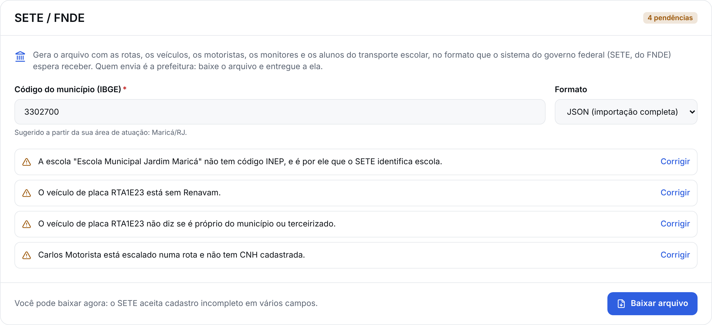
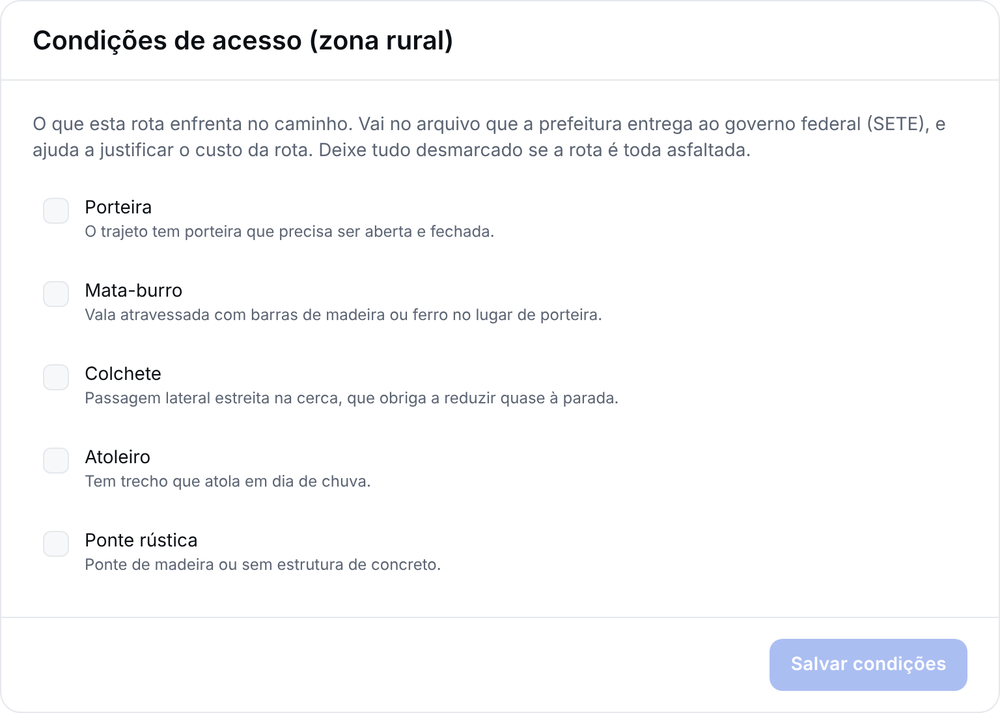
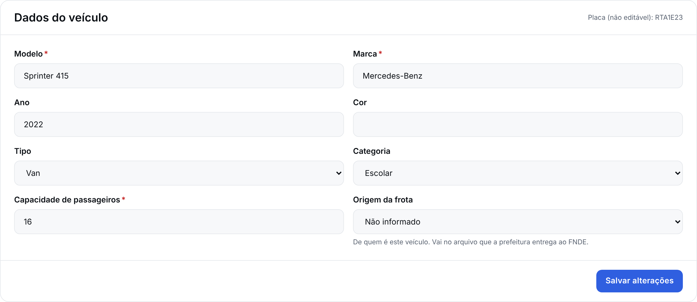
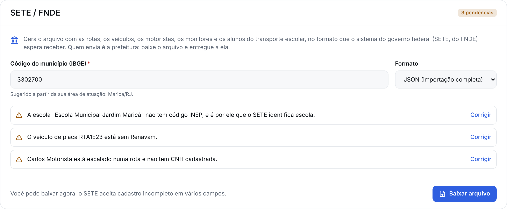

# Especificação Funcional Oficial da Rotta — Integração SETE (FNDE)

> Esta é a especificação da integração entre a Rotta e o **SETE — Sistema
> Eletrônico de Gestão do Transporte Escolar**, do FNDE. Segue o formato da
> Especificação Funcional Oficial (`docs/15-...` a `docs/21-...`): cada
> funcionalidade tem um código estável (`SETE-01`, `SETE-02`...) para
> rastreabilidade em issues, testes e código. Regras novas recebem código
> próprio (`RN-SETE-01`).

---

## Por que isto existe

O município que recebe PNATE é obrigado a usar o SETE. Hoje a prefeitura
**digita à mão** no SETE as rotas, a frota, os motoristas, os monitores e os
alunos, e ainda desenha o trajeto no mapa. A Rotta já tem quase todos esses
dados, porque eles são o produto.

O argumento comercial é direto: **com a Rotta, a prefeitura cumpre a exigência
do FNDE sem retrabalho.** A entrega acontece em duas etapas — primeiro a
exportação (que funciona sem contrato nenhum com a prefeitura), depois o envio
pela API (que depende de credencial que só a prefeitura tem).

---

## Fundamentação legal

As três leis abaixo foram lidas no acervo `ctresb/leis` em 10/11/2026, todas com
`revogada: false` e `versao_texto: "compilada (texto vigente)"`. O texto do
acervo é conversão automática e **não substitui a publicação no Diário
Oficial**: para decisão que gere obrigação, a conferência na fonte oficial é
necessária.

BRASIL. **Lei nº 13.709, de 14 de agosto de 2018**. Lei Geral de Proteção de
Dados Pessoais (LGPD). Brasília, DF: Presidência da República, 2018. Disponível
em: https://normas.leg.br/?urn=urn:lex:br:federal:lei:2018-08-14;13709. Acesso
em: 10 nov. 2026.

BRASIL. **Lei nº 10.880, de 9 de junho de 2004**. Institui o Programa Nacional
de Apoio ao Transporte do Escolar — PNATE [...]. Brasília, DF: Presidência da
República, 2004. Disponível em:
https://normas.leg.br/?urn=urn:lex:br:federal:lei:2004-06-09;10880. Acesso em:
10 nov. 2026.

BRASIL. **Lei nº 9.503, de 23 de setembro de 1997**. Institui o Código de
Trânsito Brasileiro. Brasília, DF: Presidência da República, 1997. Disponível
em: https://normas.leg.br/?urn=urn:lex:br:federal:lei:1997-09-23;9503. Acesso
em: 10 nov. 2026.

### O que cada uma determina, e onde pega nesta integração

**LGPD, art. 7º** — lista as hipóteses em que dado pessoal pode ser tratado.
Duas sustentam esta exportação: o inciso II, "para o cumprimento de obrigação
legal ou regulatória pelo controlador", e o inciso III, "pela administração
pública, para o tratamento e uso compartilhado de dados necessários à execução
de políticas públicas previstas em leis e regulamentos ou respaldadas em
contratos, convênios ou instrumentos congêneres". O PNATE é política pública
prevista em lei; alimentar o SETE é o que a norma do FNDE exige.

**LGPD, art. 11** — dado pessoal **sensível** só pode ser tratado nas hipóteses
que ele lista, e a primeira é o consentimento "de forma específica e
destacada". Cor/raça e dado de saúde (deficiência) são sensíveis. **É por isso
que esta integração nunca exporta `cor`, `def_caminhar`, `def_ouvir`,
`def_enxergar` nem `def_mental`** — ver `RN-SETE-04`.

**LGPD, art. 14** — "O tratamento de dados pessoais de crianças e de
adolescentes deverá ser realizado em seu melhor interesse", e o § 1º exige
consentimento "específico e em destaque dado por pelo menos um dos pais ou pelo
responsável legal". Todo aluno exportado é criança ou adolescente, o que coloca
o artigo inteiro sobre esta funcionalidade.

**LGPD, art. 39** — "O operador deverá realizar o tratamento segundo as
instruções fornecidas pelo controlador". Na exportação, a transportadora é a
controladora dos dados que ela cadastrou e a Rotta opera sob instrução dela; o
ato de exportar é a instrução, e é por isso que ele fica registrado em
`AuditLog` (`RN-SETE-06`).

**Lei 10.880/2004, art. 2º** — institui o PNATE "com o objetivo de oferecer
transporte escolar aos alunos da educação básica pública, residentes em área
rural, por meio de assistência financeira, em caráter suplementar, aos Estados,
ao Distrito Federal e aos Municípios". É a origem do dinheiro que torna o SETE
obrigatório, e a razão de o SETE ter campos de zona rural (porteira,
mata-burro, colchete, atoleiro, ponte rústica) que a Rotta não tinha.

**CTB, arts. 136 a 139** — o núcleo do transporte escolar. O art. 136 exige
autorização, registro como veículo de passageiros, inspeção semestral e a faixa
amarela com o dístico ESCOLAR. O art. 137 veda conduzir escolares acima da
capacidade do fabricante — o que dá sentido ao campo `capacidade` do SETE. O
art. 138 exige do condutor idade superior a 21 anos, habilitação na categoria
D, não ter cometido mais de uma infração gravíssima em 12 meses e aprovação em
curso especializado. O art. 139 é o que explica a camada municipal: "O disposto
neste Capítulo não exclui a competência municipal de aplicar as exigências
previstas em seus regulamentos, para o transporte de escolares."

### Uma norma que NÃO foi possível verificar

A **Resolução CD/FNDE nº 18/2021** é a norma que torna o SETE obrigatório para o
município que recebe PNATE. Ela **não está no acervo** `ctresb/leis`: a busca no
índice completo (1.487.341 arquivos, 10/11/2026) encontrou 22 resoluções
CD/FNDE, todas de 2024 em diante.

Por isso **o número do artigo não é citado aqui**. Registrar artigo de norma de
memória em documento que sustenta argumento comercial é o pior erro possível.
Quem for usar esta integração como argumento de venda precisa conferir o texto
em https://www.fnde.gov.br, e o mesmo vale para o Comunicado FNDE nº 004/2024.

---

## O que foi lido do SETE, e como

O código do SETE é aberto (MIT): https://github.com/umarley/seteAPI. Foi clonado
em 10/11/2026 **apenas para leitura** — nenhuma linha de PHP foi copiada para a
Rotta. O último commit é de **01/03/2023**, o que torna tudo abaixo uma
fotografia de 2023 que precisa de confirmação com o CECATE/UFG
(cecate.ufg@fnde.gov.br) antes do envio pela API.

Documentação pública: SwaggerHub `umarley/SistemaSETE/1.0.0`.

### Enums, extraídos do código (nunca inventados)

Fonte: `module/Application/src/Entity/Enum/*.php`.

| Enum               | Valores                                                                                                                                                                                                                  |
| ------------------ | ------------------------------------------------------------------------------------------------------------------------------------------------------------------------------------------------------------------------ |
| `Sexo`             | 1 Masculino, 2 Feminino, 3 Não informado                                                                                                                                                                                 |
| `CorRaca`          | **0 Não informada**, 1 Amarelo, 2 Branco, 3 Indígena, 4 Pardo, 5 Preto                                                                                                                                                   |
| `Turno`            | 1 Matutino, 2 Vespertino, 3 Integral, 4 Noturno                                                                                                                                                                          |
| `NivelAluno`       | 1 Infantil, 2 Fundamental, 3 Médio, 4 Superior, 5 Outro                                                                                                                                                                  |
| `MecTpLocalizacao` | 1 Urbana, 2 Rural                                                                                                                                                                                                        |
| `TipoVeiculo`      | 1 Ônibus, 2 Micro-ônibus, 3 Van, 4 Kombi, 5 Caminhão, 6 Caminhonete, 7 Motocicleta, 8 Animal de tração, 9 Lancha/voadeira, 10 Barco de madeira, 11 Barco de alumínio, 12 Canoa motorizada, 13 Canoa a remo, 14 Bicicleta |
| `ModoVeiculo`      | 0 Rodoviário, 1 Aquaviário                                                                                                                                                                                               |
| `Origem`           | 1 Próprio, 2 Terceirizado                                                                                                                                                                                                |
| `Rota\Tipo`        | 1 Rodoviária, 2 Aquaviário, 3 Mista                                                                                                                                                                                      |
| `GrauParentesco`   | -1 Não informado, 0 Pai/mãe/padrasto/madrasta, 1 Avós, 2 Irmã/irmão, 4 Outro parente                                                                                                                                     |

Os booleanos do SETE **não são booleanos**: são `char(1)` com `'S'` ou `'N'`, e o
default no banco é `'N'`. Vale para `da_porteira`, `da_mataburro`, `da_colchete`,
`da_atoleiro`, `da_ponterustica`, `turno_matutino`, `turno_vespertino`,
`turno_noturno`, `tem_cnh_a..e`, `turno_manha/tarde/noite` e `manutencao`.

### O formato do `shape`, confirmado por amostra real

A pergunta em aberto era se `sete_rotas.shape` é GeoJSON ou lista de pontos. Os
dados reais do dump (`bd/Anteriores/banco-dados.sql`) respondem:

```json
{"type": "FeatureCollection", "features": [{"type": "Feature",
 "geometry": {"type": "LineString", "coordinates": [[-6926991.01, -1238722.59], ...]}}]}
```

É um **GeoJSON `FeatureCollection` → `Feature` → `LineString`**. Mas as
coordenadas **não estão em graus**: `-6926991` não é longitude nenhuma. São
metros de **EPSG:3857 (Web Mercator)** — convertendo duas amostras do dump, uma
cai em Rondônia e a outra em Pernambuco, que são municípios plausíveis. Algumas
entradas têm um terceiro valor por ponto, que é a altitude.

Isso contraria o padrão GeoJSON (RFC 7946), que define WGS84 em graus. A
explicação provável é que o front do SETE usa OpenLayers, que trabalha em 3857.
**`RN-SETE-05` existe por causa disso**, e a confirmação com o CECATE é
obrigatória antes do envio pela API: mandar graus onde o SETE espera metros
desenha a rota no meio do Atlântico.

Falta um segundo detalhe, menor mas com o mesmo potencial de recusa silenciosa:
no banco do SETE a coluna `shape` é `text`, com o JSON **dentro de uma string**.
No `rotas.json` que a Rotta exporta o `shape` vai **aninhado**, que é a forma
natural num arquivo JSON e a que uma pessoa consegue ler. Se o `POST` da API
exigir a string, a conversão é de uma linha — mas é preciso saber qual das duas
antes de ligar o envio. Entrou na lista de confirmações pendentes.

---

## SETE-01 — Exportar o pacote do SETE

**Objetivo**: produzir, a partir dos dados que a transportadora já mantém na
Rotta, um pacote no formato do SETE, para a prefeitura importar ou conferir sem
redigitar nada.

**Descrição**: a transportadora pede a exportação no painel. A Rotta lê rotas,
veículos, motoristas, monitores, alunos e as ligações entre eles — **sempre
filtrando por `companyId`** — converte cada entidade para o formato do SETE e
entrega um `.zip` com um arquivo por entidade e um `LEIA-ME.txt` listando o que
ficou pendente.

**Usuários envolvidos**: Empresa, Gestor e Admin Rotta.

**Pré-requisitos**: a empresa precisa ter a tag `LICITADA`. Transportadora que
só atende família particular não presta contas ao FNDE, e oferecer o botão a ela
seria prometer utilidade que não existe.

**Fluxo principal**:

1. A pessoa abre o painel da empresa e acessa o cartão "SETE / FNDE".
2. A tela mostra o checklist de pendências (`SETE-02`) e o código IBGE sugerido.
3. A pessoa confere o código IBGE e escolhe o formato (`json` ou `csv`).
4. A pessoa aciona "Exportar para o SETE".
5. A Rotta monta o pacote, grava um `AuditLog` e devolve o `.zip`.
6. A pessoa leva o arquivo ao SETE.

**Fluxos alternativos**:

- **A1 — Empresa sem a tag `LICITADA`**: a API responde `403` e a tela não
  mostra o cartão.
- **A2 — Pacote com pendências**: a exportação **não é bloqueada**. O pacote sai
  com o que existe, e o `LEIA-ME.txt` abre com a lista do que falta. Bloquear
  obrigaria a transportadora a resolver tudo antes de ver qualquer valor, e o
  valor é justamente não redigitar.
- **A3 — Nenhuma rota ativa**: devolve pacote vazio com o `LEIA-ME.txt`
  explicando, em vez de erro — não ter rota ativa é um estado legítimo.

**Regras de negócio**:

- `RN-SETE-01` — **Isolamento por empresa.** Toda consulta da exportação roda
  dentro de `withTenant` (RLS) e leva `where: { companyId }` explícito — as duas
  coisas, não uma. Três tabelas são exceção, e não por esquecimento: `User`,
  `Student` e `School` não têm a coluna (o usuário se liga por `Membership`, a
  escola serve várias transportadoras, o aluno se liga por contrato e por rota).
  Nessas, o recorte é a **lista de ids**, sempre derivada das rotas ATIVAS desta
  empresa — que já vieram filtradas. `User` leva, por cima,
  `memberships: { some: { companyId } }`.

  Isso não é detalhe de implementação: `students` **não tem política de RLS
  nenhuma**, porque não há coluna para a política olhar. Apagar o
  `where: { companyId }` da consulta de rotas faz o nome da criança da outra
  transportadora aparecer no pacote — confirmado, quebrando de propósito, em
  `test/sete.e2e-spec.ts`. O teste de isolamento é obrigatório (`SETE-01`,
  critérios de aceite) justamente por isso.

- `RN-SETE-02` — **Só empresa `LICITADA`.** Fora disso, `403`.
- `RN-SETE-03` — **O código IBGE é sugerido, nunca imposto.** Sai da área de
  atuação da empresa (`company-service-areas`) e continua editável na tela, para
  a transportadora que atende mais de um município.
- `RN-SETE-04` — **Nenhum dado sensível sai.** `cor`, `def_caminhar`,
  `def_ouvir`, `def_enxergar`, `def_mental`, `nivel` quando derivado de
  deficiência, `necessidadesEspeciais` e `medicamentos` **nunca** aparecem na
  saída. O campo `cor` é preenchido com `0` ("Não informada"), que é o valor que
  o próprio SETE define para a ausência — não é um dado, é a declaração de que
  não há dado. Um teste falha se qualquer campo sensível aparecer no pacote.
- `RN-SETE-05` — **O `shape` vai em EPSG:3857.** Os pontos de GPS, que a Rotta
  guarda em WGS84 (graus), são projetados para Web Mercator antes de entrar no
  `shape`, e simplificados por Douglas-Peucker com tolerância de ~15 m.
- `RN-SETE-06` — **Toda exportação é auditada.** `AuditLog` grava quem exportou,
  quando, o código IBGE e as contagens por entidade. **Nenhum dado pessoal no
  log**: contagem, nunca nome.
- `RN-SETE-07` — **Horários vêm do que aconteceu, não do que foi planejado.**
  `hora_ida_inicio/termino` e `hora_volta_inicio/termino` são a mediana das
  últimas 20 viagens `FINALIZADA` de cada sentido. Sem viagem finalizada, cai
  para o `horarioPrevisto` da primeira e da última parada, e isso vira pendência
  — o SETE presta contas de operação, e planejamento não é operação.
- `RN-SETE-08` — **Posição ruim não entra na conta.** No cálculo de `km`, de
  `tempo` e do `shape`, descarta-se toda `TripPosition` com
  `simuladoSuspeito = true` ou precisão pior que 100 m.

**Permissões**: `@Roles(Role.EMPRESA, Role.GESTOR, Role.ADMIN_ROTTA)`. O perfil
de escola (`school-portal`) **não** exporta: ele enxerga alunos de mais de uma
transportadora, e dar-lhe exportação abriria uma porta de saída de dado de
criança num escopo que hoje é só de leitura.

**Validações**:

- `codigoIbge`: exatamente 7 dígitos.
- `formato`: `json` ou `csv`, nada mais.
- Placa, Renavam e CPF saem como estão na Rotta, que já os valida no cadastro.

**Mensagens exibidas**:

- Sucesso: "Pacote gerado. Confira as pendências no LEIA-ME antes de enviar ao
  SETE."
- Erro — sem a tag: "A exportação para o SETE é para transportadora que atende
  contrato público. Fale com a gente se este é o seu caso."
- Erro — código IBGE inválido: "O código IBGE tem 7 dígitos. O de Maricá é
  3302700."

**Casos excepcionais**:

- Rota ativa sem nenhuma viagem finalizada e sem `horarioPrevisto` nas paradas:
  os quatro campos de horário saem vazios e a rota entra na lista de pendências.
- Veículo sem Renavam: exportado sem o campo, e listado como pendência — o SETE
  aceita o veículo, a prestação de contas é que não fecha.
- Aluno sem coordenadas de embarque: exportado sem `loc_latitude`/
  `loc_longitude`, e listado. O SETE não recusa, mas o trajeto no mapa fica
  errado.

**Critérios de aceite**:

- **Dado** que a empresa A e a empresa B têm rotas, **quando** a empresa A
  exporta, **então** o pacote contém apenas rotas, veículos, motoristas e alunos
  de A, e nenhum identificador de B.
- **Dado** que a empresa não tem a tag `LICITADA`, **quando** chama
  `GET /sete/exportacao`, **então** recebe `403` com a mensagem de `SETE-01` e
  nenhum arquivo é gerado.
- **Dado** um aluno com `necessidadesEspeciais` preenchido, **quando** o pacote
  é gerado, **então** nenhum campo do pacote contém esse texto, e `cor` vale `0`.
- **Dado** uma rota com viagens finalizadas nos dois sentidos, **quando** o
  pacote é gerado, **então** `hora_ida_inicio` é a mediana dos horários de
  início das últimas 20 viagens de ida.
- **Dado** uma viagem cujas posições incluem pontos com `simuladoSuspeito`,
  **quando** o `shape` é montado, **então** esses pontos não aparecem no
  `LineString`.
- **Dado** qualquer exportação bem-sucedida, **quando** ela termina, **então**
  existe um `AuditLog` com o ator, o código IBGE e as contagens, e sem nome de
  pessoa.

**Possíveis melhorias futuras**: exportação incremental (só o que mudou desde a
última); pacote por rota, para a prefeitura conferir uma de cada vez.

---

## SETE-02 — Checklist de pendências

**Objetivo**: dizer à transportadora, antes de exportar, exatamente o que falta
para o pacote ficar completo — e onde corrigir cada item.

**Descrição**: `GET /sete/pendencias` devolve uma lista tipada de pendências,
cada uma com o tipo, a entidade afetada, o identificador e o caminho da tela que
resolve. A tela transforma isso em checklist com link.

**Usuários envolvidos**: Empresa, Gestor, Admin Rotta.

**Pré-requisitos**: os mesmos de `SETE-01`.

**Fluxo principal**: a tela chama o endpoint ao abrir o cartão e desenha o
checklist. Cada item leva à tela de correção. Resolvido o item, ele some na
próxima leitura.

**Regras de negócio**:

- `RN-SETE-09` — A lista de pendências **nunca** é motivo para bloquear a
  exportação (ver `A2` de `SETE-01`).
- `RN-SETE-10` — Pendência é sobre **dado que falta**, não sobre dado sensível
  que a Rotta decidiu não exportar. `cor` e os campos de deficiência **não**
  aparecem como pendência: eles são uma decisão, não uma lacuna.

**Tipos de pendência previstos**:

| Tipo                    | O que significa                                            |
| ----------------------- | ---------------------------------------------------------- |
| `ESCOLA_SEM_INEP`       | `School.codigoInep` vazio: o SETE casa escola pelo INEP    |
| `ROTA_SEM_GPS`          | nenhuma viagem com posição confiável: sem `km` e sem shape |
| `ROTA_SEM_HORARIO`      | sem viagem finalizada e sem `horarioPrevisto` nas paradas  |
| `MOTORISTA_SEM_CNH`     | sem `DriverDocument` CNH válido                            |
| `MOTORISTA_CNH_VENCIDA` | CNH com `vencimentoEm` no passado                          |
| `VEICULO_SEM_RENAVAM`   | `Vehicle.renavam` vazio                                    |
| `VEICULO_SEM_ORIGEM`    | `Vehicle.origemFrota` nulo (próprio ou terceirizado)       |
| `ALUNO_SEM_COORDENADA`  | `embarqueLatitude`/`embarqueLongitude` vazios              |
| `ALUNO_SEM_RESPONSAVEL` | contrato sem responsável com telefone                      |

**Critérios de aceite**:

- **Dado** uma escola sem `codigoInep` numa rota ativa, **quando** a tela carrega
  as pendências, **então** existe um item `ESCOLA_SEM_INEP` apontando aquela
  escola.
- **Dado** um motorista com CNH vencida ontem, **quando** as pendências são
  calculadas, **então** o item é `MOTORISTA_CNH_VENCIDA`, não
  `MOTORISTA_SEM_CNH`.
- **Dado** um aluno com `necessidadesEspeciais`, **quando** as pendências são
  calculadas, **então** nenhuma pendência menciona deficiência ou cor.

---

## SETE-03 — Campos que o SETE pede e a Rotta não tinha

**Objetivo**: guardar, na Rotta, os campos que o SETE exige e que o produto
nunca precisou — sem inventar dado na hora da exportação.

**Descrição**: três grupos de campos entram no schema.

**Regras de negócio**:

- `RN-SETE-11` — **Condições de acesso da rota.** `Route` ganha
  `acessoPorteira`, `acessoMataBurro`, `acessoColchete`, `acessoAtoleiro` e
  `acessoPonteRustica`, booleanos com default `false`. São campos de zona rural,
  e existem porque o PNATE é um programa de área rural (Lei 10.880/2004, art.
  2º). Default `false` é o mesmo default do SETE (`'N'`).
- `RN-SETE-12` — **Origem da frota.** `Vehicle` ganha
  `origemFrota VehicleOwnership?` (`PROPRIO_MUNICIPIO`, `TERCEIRIZADO`),
  opcional. Opcional de propósito: nulo é "ninguém informou ainda", e vira
  pendência; um default mentiria.
- `RN-SETE-13` — **Data de nascimento e sexo de motorista e monitor NÃO são
  coletados nesta entrega.** O SETE pede os dois (`sete_motoristas.
data_nascimento`, `sete_motoristas.sexo`), e a Rotta não os tem. Coletá-los
  seria dado pessoal novo, exigiria atualizar a Política de Privacidade e, com
  ela, uma nova versão de consentimento — que força reaceite de todos os
  usuários. **Decisão do fundador em 10/11/2026: não coletar agora.** Os dois
  campos saem vazios, a prefeitura os completa à mão no SETE (são dois campos
  por pessoa, uma vez), e a coleta fica em "Melhorias futuras".

**Validações**: os cinco booleanos de acesso aceitam só `true`/`false`;
`origemFrota` aceita só os dois valores do enum ou nulo.

**Critérios de aceite**:

- **Dado** uma rota criada sem informar acesso, **quando** ela é lida, **então**
  os cinco campos valem `false`.
- **Dado** um veículo sem `origemFrota`, **quando** as pendências são
  calculadas, **então** existe um item `VEICULO_SEM_ORIGEM`.

---

## SETE-04 — Cliente da API do SETE (preparado, desligado)

**Objetivo**: deixar o envio direto pronto, sem ligá-lo, porque ele depende de
credencial da prefeitura e de confirmação de endpoints que só o CECATE dá.

**Descrição**: `SeteApiClient` autentica em `POST /authenticator/sete` e envia
por recurso (`/rotas/{codigo_cidade}`, `/veiculos/...`, `/motoristas/...`,
`/monitores/...`, `/alunos/...`), com o token no header `Authorization`.

**Pré-requisitos**: `SETE_SYNC_ENABLED=true` e `SETE_API_URL` configurados.
Ambos documentados em `.env.example`; o padrão de `SETE_SYNC_ENABLED` é `false`.

**Regras de negócio**:

- `RN-SETE-14` — **Nenhuma credencial da prefeitura é armazenada nesta
  entrega.** O token é passado na chamada e vive só na memória da requisição.
  Guardar credencial de órgão público pede cofre e rotação, e isso é escopo
  próprio — está em "Melhorias futuras".
- `RN-SETE-15` — **Desligado por padrão.** Com `SETE_SYNC_ENABLED=false`,
  qualquer chamada ao cliente falha cedo com mensagem explícita, em vez de tentar
  rede.
- `RN-SETE-16` — **Nenhuma chamada real ao SETE nesta entrega.** Os testes usam
  mock HTTP. O código público é de 01/03/2023 e os endpoints de produção podem
  ter mudado.

**Casos excepcionais**: `401` do SETE significa token expirado, e a mensagem diz
isso em vez de "erro inesperado"; `422` traz a lista de validações do SETE, que é
repassada item a item.

**Critérios de aceite**:

- **Dado** `SETE_SYNC_ENABLED=false`, **quando** o cliente é chamado, **então**
  ele recusa antes de abrir conexão, com mensagem que nomeia a variável.
- **Dado** um mock que devolve `401`, **quando** o envio é tentado, **então** a
  mensagem fala em token expirado.

---

## SETE-05 — Tela "Exportar para o SETE"

**Objetivo**: dar à transportadora um lugar onde ela entende o que é o SETE,
vê o que falta e gera o pacote.

**Descrição**: cartão "SETE / FNDE" no painel da empresa, visível só para
`LICITADA`. Traz um texto curto sem jargão, o checklist de `SETE-02` com link
por item, o campo de código IBGE já preenchido e editável, e o botão de
exportar.

Em "editar rota", os cinco campos de acesso aparecem como caixas de seleção sob
o título "Condições de acesso (zona rural)". Em "editar veículo", o campo
"Origem da frota".

**Permissões**: as mesmas de `SETE-01`.

**Mensagens exibidas**: ver `SETE-01`.

**Critérios de aceite**:

- **Dado** uma empresa sem `LICITADA`, **quando** ela abre o painel, **então** o
  cartão não aparece.
- **Dado** o contraste da tela, **quando** medido, **então** atende WCAG AA, como
  já cobrado em `contraste-wcag.spec.ts`.

**Como ficou** (10/11/2026, capturado da aplicação rodando contra banco
semeado — `docs/prints/sete/`):







Corrigir uma pendência e voltar ao painel: a contagem cai, e o item some.



**Decisões de implementação** (10/11/2026): o recorte por `LICITADA` mora dentro de
`SeteCard` e de `AcessoRuralCard`, não nas páginas que os montam. Duas razões: o
teste do recorte não precisa montar o painel inteiro, e a próxima tela que
quiser um desses cartões não pode esquecer de repetir a condição. `temTag`
devolve `true` enquanto a empresa não carregou — um cartão que pisca a cada
navegação é pior que um cartão que o backend recusa, e é o backend que barra de
verdade.

Em "editar veículo" o recorte ficou embutido no próprio campo, porque ali é um
campo de um formulário que já existe, não um cartão.

**Decisão tomada sem perguntar, e que vale revisar**: as cinco caixas da zona
rural e o campo "Origem da frota" também só aparecem para `LICITADA`. O pedido
original só exigia o recorte no cartão do painel. A escolha foi não pôr seis
campos sem destino em toda rota e todo veículo de transportadora privada — mas é
uma escolha, e desfazê-la é trocar a condição por `true`.

**Possíveis melhorias futuras**: mobile (fora do escopo desta entrega).

---

## O que depende da prefeitura e do FNDE

1. **Confirmar os endpoints com o CECATE/UFG** (cecate.ufg@fnde.gov.br). O
   código público é de 01/03/2023.
2. **Confirmar o CRS do `shape`.** A evidência diz EPSG:3857; o padrão GeoJSON
   diz WGS84. Errar põe a rota no oceano.
3. **Confirmar se o `shape` vai como objeto ou como string JSON.** No banco do
   SETE a coluna é `text`; o arquivo da Rotta manda o objeto aninhado.
4. **Conferir a Resolução CD/FNDE nº 18/2021** na fonte oficial — ela não está
   no acervo de leis, e o número do artigo não foi citado aqui por isso.
5. **Credencial de acesso ao SETE**, que só a prefeitura emite.

## A restrição que o `/importacao` impõe

O endpoint de importação em lote do SETE (`ImportacaoModel::validarAlunos`) só
aceita aluno, e exige `nome`, `data_nascimento`, `sexo`, **`cor`**, `turno`,
`nivel` e `mec_tp_localizacao`. Três consequências:

- `cor` é obrigatório, e a validação recusa apenas a string vazia. Como
  `CorRaca::NAO_INFORMADA = 0`, mandar `0` **passa** sem jamais tratar cor/raça
  — é o que `RN-SETE-04` faz.
- `nivel` não aceita vazio nem zero. Ele é derivado de `School.tipos` e, quando
  não der para derivar, o aluno entra em pendência.
- `mec_tp_localizacao` (urbana/rural) não existe na Rotta. É derivado das
  condições de acesso da rota (`RN-SETE-11`): rota com qualquer condição rural
  marcada ⇒ `2` (rural), senão `1` (urbana). **É heurística, não fato**, e está
  registrada como tal.

---

## Melhorias futuras

- Coletar data de nascimento e sexo de motorista e monitor, com a atualização de
  Política de Privacidade que isso exige (`RN-SETE-13`).
- Armazenamento criptografado da credencial da prefeitura, com rotação
  (`RN-SETE-14`).
- Envio incremental e reconciliação (o que o SETE já tem × o que a Rotta tem).
- Exportação para o perfil de escola, com recorte próprio (hoje fora, por
  decisão de 10/11/2026).
